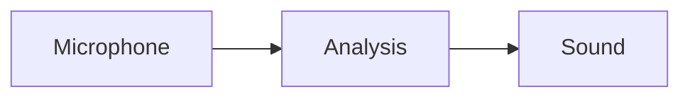

# AI guide: authoring slides in this repository

This file applies to the whole repository. When a task concerns presentations, talks, or lesson slides, follow this guide and preserve the existing presentation runtime.

## Choose the correct slide system

Prefer a Markdown talk for new presentations:

```text
talks/<YYYY-MM-Short-Name>/
├── slide.md
├── image.avif
└── example.mp3
```

The shared viewer is `talks/slide.html`; do not copy it into each presentation. Assets may sit beside `slide.md`, and relative URLs are resolved from that presentation directory.

Use a standalone `index.html` only when the presentation genuinely needs custom JavaScript, a custom application runtime, or layout behavior that the Markdown renderer cannot express. A folder URL prefers `index.html` and falls back to `slide.md`. If both exist and Markdown must win, use an explicit `./folder/slide.md` link in `talks/talks.json`.

Class lessons in `classes/<year>/<course>/aulaN.md` use the same Markdown parser, transitions, Mermaid renderer, MathJax, image zoom, code highlighting, and audio waveform player. Their catalog, password gate, and navigation are different; see “Class lessons” below.

## Creating a talk

1. Create `talks/<presentation>/slide.md` and keep its media in that folder when practical.
2. Add one object to `talks/talks.json`:

   ```json
   {
       "title": "Presentation title",
       "link": "./2026-11-Presentation/slide.md",
       "language": "🇧🇷",
       "date": "08/11/2026",
       "description": "A concise description.",
       "encrypt": false
   }
   ```

3. Use the exact key `encrypt`; do not invent variants. Dates conventionally use `DD/MM/YYYY`.
4. Preview through HTTP from the repository root:

   ```sh
   python3 -m http.server 8000
   ```

   Then open `http://localhost:8000/talks/slide.html?talk=/talks/<presentation>/slide.md` or open `http://localhost:8000/talks/` and use the catalog card.

Do not preview by opening the file directly with `file://`; the viewer fetches Markdown and media over HTTP.

## Slide structure

The renderer splits slides only at level-one and level-two Markdown headings:

```markdown
# Presentation title

Author Name

Institution

## First content slide

- First point
- Second point

### A subheading on the same slide

This remains on the current slide.

## Next slide

More content.
```

- Use one initial `#` for the title slide.
- Use `##` for every subsequent slide.
- Use `###` and smaller headings inside the current slide.
- Do not use `---` as a slide separator. It becomes a horizontal rule inside the current slide.
- Do not add YAML front matter; there is no front-matter parser.
- Keep slides concise enough for a 700 px-high desktop canvas and a phone viewport. Split overflowing material into more slides.

Standard Markdown supported by Marked includes paragraphs, ordered and unordered lists, nested lists, blockquotes, links, images, tables, inline formatting, inline code, fenced code, and raw HTML. Fenced code is syntax-highlighted when a language is supplied:

````markdown
```javascript
const answer = 42;
```
````

Raw HTML is appropriate for flex/grid layouts, videos, iframes, and Reveal utility classes such as `r-stack`. Scripts inserted inside Markdown are not a supported extension mechanism; use a standalone HTML presentation when custom runtime code is required.

## Relative assets and embeds

The talk viewer rebases relative `src`, `href`, `poster`, and `data-src` values against `slide.md`. Prefer relative paths for presentation-owned assets:

```markdown
{width="65%"}

[Open the handout](handout.pdf){target="_blank"}

<video src="demo.mp4" poster="poster.avif" controls></video>

<iframe
  width="560"
  height="315"
  src="https://www.youtube.com/embed/VIDEO_ID"
  title="Video title"
  allowfullscreen>
</iframe>
```

Root-relative URLs such as `/images/shared.avif`, absolute URLs, `data:` URLs, and hash links are left unchanged. All rendered images are automatically clickable and keyboard-focusable: click them, or press Enter/Space, to open the full-screen zoom dialog.

Use meaningful image `alt` text and iframe/video titles. Prefer AVIF for photographic or large raster images when it does not harm the source material; preserve SVG for diagrams and logos.

## Audio and waveforms

Both `<audio>` and the custom `<wave>` element are upgraded to the shared WaveSurfer waveform card when their slide becomes active:

```markdown
## Audio example

<audio src="example.mp3"></audio>
```

or:

```markdown
<wave src="example.mp3"></wave>
```

Important behavior:

- Put the URL directly in the element's `src`; nested `<source>` elements are not read by the enhancer.
- A local MP3 beside `slide.md` is the most reliable option. Other browser-decodable formats can work, but test them in the target browser.
- On desktop, click the waveform to play/pause. While it is hovered, Space also toggles it.
- On coarse-pointer/touch devices, tapping a stopped waveform starts it from the beginning; tapping a playing waveform pauses it.
- Multiple audio elements inside a flex layout are detected as a group and stack vertically on mobile.
- The native `controls` attribute may be written, but the runtime replaces the audio element with the waveform UI.
- Remote audio must permit browser/CORS access. Prefer repository-local media for a self-contained talk.

Do not add a second audio library or write presentation-specific waveform code unless the requested behavior cannot be achieved by the shared enhancer in `js/markdown2slide.js`.

## QR codes

Use the custom `<qrcode>` element to generate a QR image from a non-empty link when its slide becomes active:

```html
<qrcode
  link="https://example.com/handout"
  title="Presentation handout"
  alt="QR code for the presentation handout">
</qrcode>
```

`title` and `alt` are optional. The default QR code is 240 px wide; use a local `style="width: 200px"` when a slide needs another size. Prefer an absolute or root-relative URL. The renderer uses the bundled `js/qrcode-generator.js`; do not add an external QR service or another QR library.

## Mermaid diagrams

Use a fenced block labeled `mermaid`:

````markdown
## Processing flow


````

The runtime converts Mermaid fences into diagram containers, renders only the active slide, and scales the resulting SVG to the available slide height. Keep diagrams readable:

- Prefer `flowchart LR` for short pipelines and `flowchart TB` for deeper hierarchies.
- Keep node text short and reduce crossings.
- Use Mermaid `%%{init: ... }%%` configuration inside the block for diagram-specific font/theme settings.
- Use syntax supported by the bundled `js/mermaid.min.js`; do not assume features from the newest online Mermaid release.
- Do not add screenshots of diagrams when editable Mermaid source can express them.

## Mathematics

MathJax is bundled and typesets after the deck initializes. Use explicit TeX delimiters:

```markdown
Inline mathematics: \(f(x) = x^2\).

\[
E = mc^2
\]
```

The parser also supports the repository's `$$...$$` shorthand. A `$$...$$` expression sharing a line with prose is converted to inline math; a standalone expression remains display math:

```markdown
The ratio is $$\frac{3}{2}$$.

$$E = mc^2$$
```

Keep TeX out of code fences, which MathJax intentionally skips.

## Trailing attributes and styling

The Markdown renderer accepts a trailing attribute block using only double-quoted values:

```markdown
## Large heading {font-size="58px" color="#0f172a"}

Centered text {text-align="center" font-size="30px"}

- Emphasized point {font-size="32px" color="teal"}

{width="60%" opacity="0.9"}

[Documentation](notes.pdf){target="_blank" color="#2563eb"}
```

Attribute rules:

- `id`, `class`, `width`, `height`, `src`, `href`, `alt`, `title`, `target`, and every `data-*` name become HTML attributes.
- Other names become CSS declarations. Write `font-size="32px"`, not CSS colon syntax.
- Attribute values must use double quotes.
- Attribute blocks work on headings, paragraphs, list items, images, links, tables, bold, italic, strikethrough, and inline code.
- For a table, put the block at the end of the header row; it styles the table and does not create another column:

  ```markdown
  | Model | Cost | {font-size="24px"}
  |---|---:|
  | Small | Low |
  ```

### Style memory is intentional

CSS declarations in trailing attributes become defaults for later elements of the same renderer type throughout that presentation. For example, after one `##` uses `font-size="58px"`, later `##` headings inherit it until another `##` changes it. The same applies independently to paragraphs, list items, images, links, tables, bold, italic, strikethrough, inline code, and each heading level.

HTML attributes such as `id`, `target`, `width`, `class`, and `data-*` remain local and are not inherited.

Use this behavior deliberately to establish a visual default near the beginning of a deck. If only one unusual element should differ, explicitly restore the intended default on the next element of that type. Raw HTML `style` attributes are always local and can be preferable for one-off layouts.

## Slide transitions and fragments

A transition on `#` or `##` applies to the whole slide section:

```markdown
## Architecture {data-transition="zoom" data-transition-speed="fast"}
```

Slide transitions support Reveal transition names such as `none`, `fade`, `slide`, `convex`, `concave`, and `zoom`. Separate entry/exit values also work, for example `data-transition="slide-in fade-out"`. Transition speed may be `default`, `fast`, or `slow`.

On content, `data-transition` creates a Reveal fragment revealed on a later step:

```markdown
Text appears later. {data-transition="fade"}

- First point {data-transition="slide"}
- Second point {data-transition="zoom" data-fragment-index="1"}

**Temporary emphasis** {data-transition="fade-in-then-out"}
```

Fragment aliases are:

- `fade` → `fade-in`
- `zoom` → `zoom-in`
- `slide` → `fade-left`
- `none` → `instant`

Native Reveal fragment effects may be used directly, including `fade-up`, `fade-down`, `fade-left`, `fade-right`, `grow`, `shrink`, and `fade-in-then-out`. Existing classes and `data-fragment-index` are preserved. Raw HTML also participates:

```html
<div class="fragment fade-up">Revealed HTML</div>
<ul><li data-transition="zoom">Revealed item</li></ul>
```

Use fragments sparingly and preserve reading order. Never hide information required to understand the static first view without a clear presentation reason.

## Layout patterns

Use Markdown for ordinary content and small raw-HTML wrappers for composed layouts:

```html
<div style="display: flex; gap: 24px; align-items: center;">
  <div style="width: 50%;">
    
  </div>
  <div style="width: 50%;">
    
  </div>
</div>
```

For layered fragment images, Reveal's existing `r-stack` class is available:

```html
<div class="r-stack">
  
  
</div>
```

The shared talk CSS already supplies title-slide centering, logo rows via `.logos`, Mermaid sizing, image zoom, code styling, waveform cards, and mobile adaptations. Prefer these shared capabilities over presentation-specific CSS. If a broadly reusable improvement is needed, update `css/talks/my-style.css`, `css/code-highlight.css`, or `css/slide-transitions.css` and test existing decks. Presentation-specific styles belong under `css/talks/<presentation>/` only when truly specific.

## Runtime capabilities and limits

The Markdown talk runtime currently provides:

- Reveal navigation, URL hashes, and slide numbers.
- Responsive dimensions: a 700 px-high desktop deck and full-viewport mobile slides at 900 px or below.
- Marked Markdown plus raw HTML.
- Highlight.js code blocks.
- MathJax TeX rendering.
- Mermaid diagrams rendered and fitted when their slide activates.
- WaveSurfer audio cards rendered when their slide activates.
- Click/keyboard full-screen image zoom.
- Slide and element transitions/fragments.
- Relative URL rebasing for media and links.
- Automatic document title from the first rendered heading.
- Optional StatiCrypt protection.

The Markdown runtime does not implement YAML front matter, `---` slide splitting, nested Reveal vertical slides, speaker notes, per-slide background attributes, or arbitrary executable scripts. Do not promise these features. Use a standalone HTML deck or extend the shared runtime with tests when a task truly requires one of them.

## Encryption workflow

`encrypt` in `talks/talks.json` is the desired state:

- `false`: keep the presentation public and plaintext.
- `true`: protect the viewer and Markdown with StatiCrypt.

The command processes every catalog entry, not just one presentation:

```sh
python3 talks/encrypt.py
```

It prompts once for the presentation password. Automation may use `STATICRYPT_PASSWORD`. Use `--no-tailwind` only when intentionally skipping the shared talk stylesheet rebuild:

```sh
STATICRYPT_PASSWORD='…' python3 talks/encrypt.py --no-tailwind
```

Requirements are the `staticrypt` executable and, unless `--no-tailwind` is supplied, the Tailwind CSS CLI.

Never hand-edit ciphertext JSON in an encrypted `slide.md` or the generated `index.html`/locked JS assets. To edit an existing protected deck safely:

1. Set its catalog `encrypt` value to `false`.
2. Run `python3 talks/encrypt.py` with the correct password to restore plaintext.
3. Edit and preview `slide.md`.
4. Set `encrypt` back to `true`.
5. Run the encryption command again and verify the password page and unlocked deck.

The script prepares all changes before replacement and preserves unchanged files, but a wrong password or malformed payload aborts the operation. Do not remove generated encryption assets manually.

## Class lessons

For a lesson in an existing course, add or edit `classes/<year>/<course>/aulaN.md` and place course-specific media in or below that course directory. `course.json` controls:

- `title` and `description`
- `encrypt`, the desired lesson state (`true` for ciphertext, `false` for plaintext)
- `lessonPrefix`, normally `aula`
- `lessonExtension`, normally `.md`
- `maxLessons`, the discovery ceiling

The course page discovers numbered lesson files; there is no lesson array to update. `classes/classes.json` controls which course cards are listed. The classes homepage shows only entries for the current year and honors the entry's `render` flag.

Protected course Markdown uses the same authenticated StatiCrypt payload format as protected talks. Every numbered lesson in one course shares a random salt so the browser derives the expensive key once. The plaintext password is never stored; only the derived key lives in `sessionStorage`. Public `course.json` files must not retain `password` or `passwordHash`, because either provides a faster offline password verifier than the ciphertext.

Apply the configured state to every listed course with:

```sh
python3 classes/encrypt.py
```

For the first migration, the script may consume an existing SHA-256 `passwordHash` as the normalized encryption secret and then removes it. Later encryption/decryption prompts per course. Automation may set one plaintext `CLASS_PASSWORD` for all selected courses or a JSON `CLASS_PASSWORDS` mapping keyed by the `classes.json` course path. Never put passwords on the command line or commit them.

To edit a protected lesson, set its course's `encrypt` to `false`, run the command and supply the password, edit and preview the plaintext Markdown, set `encrypt` back to `true`, and run the command again. The script prepares every course before replacing files; wrong passwords, mixed salts, or malformed ciphertext abort without partial changes. Do not hand-edit ciphertext JSON.

Preview through `http://localhost:8000/classes/`, unlock the course through its course page, and then open the lesson. Direct lesson URLs redirect to the course gate when the current browser session has not derived the course key. Images, audio, PDFs, Typst, and other linked assets are not encrypted by this workflow and must be public-safe or kept out of the repository.

## Verification

For documentation-only or content-only slide changes, at minimum:

1. Serve the repository over HTTP.
2. Open the presentation through the shared viewer.
3. Navigate every slide and every fragment.
4. Exercise each Mermaid diagram, audio waveform, video/iframe, link, math expression, and image zoom.
5. Check one desktop viewport and one viewport at or below 900 px.
6. Confirm the browser console has no load, Mermaid, MathJax, WaveSurfer, or missing-asset errors.

When changing the shared Markdown/runtime code, run:

```sh
node --test talks/test-talks.cjs
node --test classes/test-classes.cjs
python3 -m unittest discover -s scripts -p 'test_talk_encryption.py' -v
python3 -m unittest discover -s scripts -p 'test_class_encryption.py' -v
```

The encryption suite skips itself if StatiCrypt or Node.js is unavailable. If shared CSS changes, rebuild the relevant stylesheet:

```sh
tailwindcss -i css/talks/input.css -o css/talks/output.css
tailwindcss -i css/classes/input.css -o css/classes/output.css
```

Run only the build(s) affected by the change. Do not regenerate unrelated presentation assets or rewrite encrypted decks as part of an ordinary slide-content task.

## Editing principles for AI agents

- Inspect nearby talks and the shared runtime before inventing new syntax.
- Prefer `slide.md` plus local assets over a copied HTML shell.
- Preserve the author's language, terminology, citation details, and visual intent.
- Do not fabricate facts, citations, institutional logos, audio, or images. Ask for missing source material or use clearly marked placeholders when the task requires assets the repository does not contain.
- Keep paths portable and case-correct for GitHub Pages.
- Do not expose passwords, plaintext from protected presentations, or encrypted presentation contents in logs or summaries.
- Avoid unrelated formatting changes in `talks/talks.json`, class catalogs, generated CSS, and encrypted assets.
- If extending a shared capability, add or update the relevant talk/class tests and document the authoring syntax here and in the matching README.
