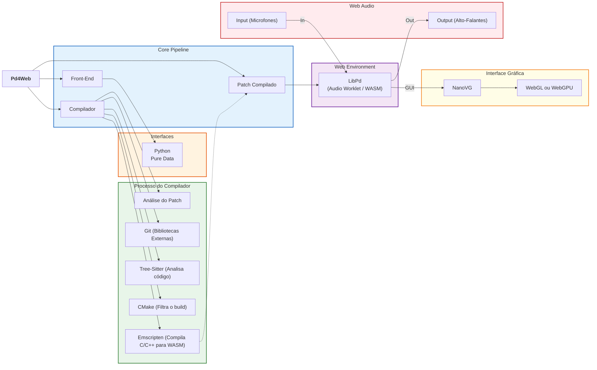
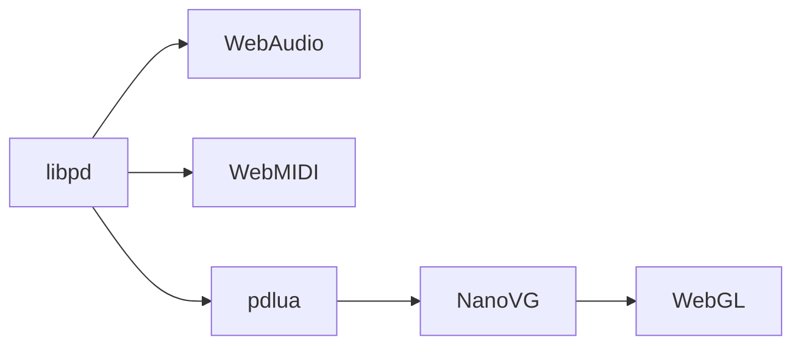

# pd4web: Programação Criativa na Web

<h3>Introdução</h3>

Charles K. Neimog{margin-top="300px"}

Universidade de São Paulo

## Conteúdo | Módulo 1 | (10/04)

* _Introdução, Documentação e Artigos;_
* _Front-end, Instalação; Configuração, Compilação e Upload;_
    * Pure Data e Python;
    * _Em caso de problemas resolvemos durante essa semana de iato_;
* _Compilador e **como** funciona_;
    * Processador do patch;
    * Gerenciador de bibliotecas;
    * Download de código fonte e Compilação;
* _Pd4Web e WebAudio_;
    * Processamento de áudio;
    * WebAudio;
* _Exemplos_ Projetos;

## Conteúdo | Módulo 2 | (24/04)

* Integrações;
    * _p5js_ (gráficos 2d);
    * _ml5_ (detecção de mãos);
    * _vexflox_ (partitura);
    * _threejs_ (gráficos 3d);
* Projetos;

## **Introdução** | Artigo | Documentação

  

    
    
Eco 1 (2022)

  

  

    
    
Moteto (2022)

  

## Introdução | **Artigo** | Documentação

[Artigo](https://www.researchgate.net/publication/395664963_Enabling_Interactive_Music_Performance_through_Web_Browsers_for_non-Programmers){align="center"; target="_blank"}

{width="50%"}

## Introdução | Artigo | **Documentação**

[https://charlesneimog.github.io/pd4web](https://charlesneimog.github.io/pd4web){align="center"; target="_blank"}

{width="50%"}

## Instalação (Pd)

* Python: `pip install pd4web`
* PureData: Tools->Find Externals, procure por `pd4web`, instale!

## Instalação (Pd)

* Em alguns casos, pode ser necessário instalar Python manualmente.
    * MacOS: [https://www.python.org/downloads/](https://www.python.org/downloads/);
    * Linux;
        * `apt install python3`;
        * `pacman install python3`;
        * `dnf install python3`;
    * Windows: O `pd4web` vai instalar automaticamente;

## Instalação e Compilação (Pd)

## Instalação e Compilação (Python)

* `pip install pd4web`;
* `pip install --upgrade pd4web`;
* `pd4web hello-world.pd`;

## Configuração e Demonstração

[https://charlesneimog.github.io/pd4web/patch/compile/](https://charlesneimog.github.io/pd4web/patch/compile/)

## Desenvolvimento de patches

* Sobre Arquivos de Áudio;
* Sobre SubPatches;

## Upload

* Tudo é empacotado dentro da pasta `WebPatch`;

## Errors Comuns

* Memória, arquivos não encontrados;

## **Como** funciona

## Como funciona (Compilação)

* A parte maior do projeto é o compilador;
    * Análise do Patch (`Sources/Compiler/patch.cpp`);
    * Git (Bibliotecas Externas) (`Sources/Compiler/git.cpp`);
    * Tree-Sitter (Analisa código) (`Sources/Compiler/libraries.cpp`);
    * CMake (Filtra o build) (`Sources/Compiler/builder.cpp`);
    * Emscripten (Compila C/C++ para WASM) (`Sources/Compiler/utils.cpp`);

## Como funciona (WebAudio)

* Parte de Audio (`Sources/Pd4Web/pd4web.cpp`);
* Parte Gráfica (`Sources/Pd4Web/pd4weblua_gfx.c` e `Sources/Pd4Web/pd4web.cpp`);

## Perguntas ou Questões?

## Exemplos e Projetos

* [Moteto I](https://charlesneimog.github.io/Pandemonio/WebPatch/index.html);
* [Cânticos de Silício I](https://charlesneimog.github.io/Canticos-de-Silicio-I/);
* [Local Maxima](https://charlesneimog.github.io/Tese/Pages/Local-Maxima/WebPatch/index.html);
* [Improviso](https://charlesneimog.github.io/Improviso-I/);
* [Algorithm I](https://charlesneimog.github.io/Algorithm-Music/Piece-I/webpatch/index.html);
* [BiA](https://nucleomusicanova.github.io/BiA/);

## Módulo 2 - pd4web + libraries
