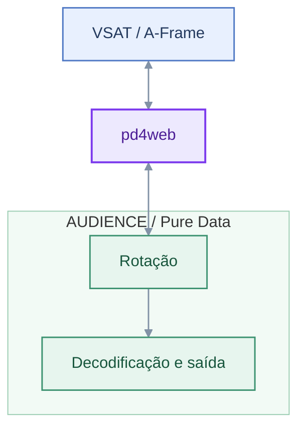

# pd4web na integração com VSAT/AUDIENCE

Charles K. Neimog

---

## Contexto do projeto

- **VSAT**: plataforma web de narrativas imersivas em 360°
- **AUDIENCE**: motor de áudio espacial desenvolvido em Pure Data
- **Objetivo**: integrar imagem 360° e áudio espacial interativo
- **Desafio**: executar o processamento do Pure Data no navegador

---

## O que é o pd4web?

- Framework open-source para executar patches de Pure Data no navegador
- Compilação de Pd e bibliotecas externas para WebAssembly
- Processamento de áudio em tempo real com AudioWorklet
- Comunicação bidirecional entre JavaScript e Pure Data
- Reutilização de patches existentes em aplicações web

---

## Arquitetura da integração



---

## Compilação e registro dos externos

1. Download das dependências (repositórios Git) {font-size="25px"}
2. Análise do código-fonte e identificação das funções de inicialização
3. Geração automática do código de registro dos externos

<div style="font-size: 28px">

```cpp
// Automatically generated by pd4web

extern "C" void audce_L4_amb_rot_tilde_setup(void);
extern "C" void audce_L4_amb_3rd_tilde_setup(void);

void Pd4WebInitExternals() {
    audce_L4_amb_rot_tilde_setup();
    audce_L4_amb_3rd_tilde_setup();
}
```

</div>

**Reutilização dos objetos do AUDIENCE sem reimplementação em JavaScript.** {font-size="20px"}

## Inicialização do AUDIENCE no navegador

<div style="font-size: 20px">

```cpp
void Pd4Web::OpenPatch(std::string PatchPath, std::string PatchCanvaId, std::string soundToggleId) {

    // ...
    libpd_add_to_search_path("./Libs/");
    libpd_add_to_search_path("./Extras/");
    libpd_add_to_search_path("./Audios/");
    libpd_add_to_search_path("./Gui/");

    pdlua_setup();
    Pd4WebInitExternals();

    // Open patch
    if (!libpd_openfile(PatchPath.c_str(), "./")) {
        JS_Alert("Failed to open patch | Please Report!");
        return;
    }

    // Pd initialized with AUDIENCE externals
    // ...
}
```

</div>

- Registro dos objetos externos
- Inicialização do patch com `libpd`
- Execução do AUDIENCE no navegador

## Browser | AudioWorklet | Threads

<div style="font-size: 20px">

- `pd4web` + `AUDIENCE`: executados na thread de áudio (`AudioWorklet`);
- `A-Frame` + interface gráfica: executados na thread principal do navegador.

**Benefícios:**
- Processamento de áudio independente da renderização gráfica;
- Menor risco de interrupções no áudio causadas pela interface;
- Execução de DSP em contexto dedicado de áudio.

**Desafios:**
- Comunicação assíncrona entre threads;
- Necessidade de sincronização das mensagens;
- Latência na transmissão de comandos e parâmetros.

</div>

## Comunicação entre A-Frame e Pure Data

**Envio da orientação da câmera para o patch**

<div style="font-size: 25px">

```javascript
AFRAME.registerComponent("watch-transform", {
    schema: {
        eps: { type: "number", default: 0.1 }
    },

    tick: function () {
        const direction = new THREE.Vector3();

        this.el.object3D.getWorldDirection(direction);

        if (Pd4Web) {
            Pd4Web.sendList("ori_rcv", [
                direction.x,
                direction.y,
                direction.z
            ]);
        }
    }
});
```

</div>

## Comunicação entre A-Frame e Pure Data

- A-Frame fornece a orientação da câmera;
- JavaScript envia os parâmetros ao pd4web;
- O AUDIENCE utiliza os dados para rotacionar a cena sonora.

---

## Sincronização de mensagens

**1. JavaScript → fila de mensagens**

<div style="font-size: 20px">

```cpp
bool Pd4Web::SendList(std::string s, emscripten::val a) {
    if (!a.isArray()) {
        emscripten_log(EM_LOG_ERROR, "SendList: argument is not an array");
        return false;
    }

    size_t length = a["length"].as<size_t>();
    std::vector<Pd4WebAtom> atoms;
    atoms.reserve(length);

    for (size_t i = 0; i < length; ++i) {
        emscripten::val v = a[i];

        if (v.isNumber()) {
            atoms.push_back(Pd4WebAtom(v.as<float>()));
        } else if (v.isString()) {
            atoms.push_back(Pd4WebAtom(v.as<std::string>()));
        }
    }

    auto sender = Pd4WebSender::CreateList(s, atoms);

    std::lock_guard<std::mutex> lock(m_ToSendMutex);
    m_ToSendData.push_back(sender);

    return true;
}
```
</div>

---

## Sincronização de mensagens

**2. Fila → Pure Data** {font-size="30px"}

<div style="font-size: 15px">

```cpp
static void ProcessSenders(Pd4WebUserData *ud) {
    while (const auto *sender = ud->pd4web->BeginSender()) {
        switch (sender->type) {
        case BANG:
            libpd_bang(sender->receiver);
            break;

        case FLOAT:
            libpd_float(sender->receiver, sender->f_value);
            break;

        // ...
        }
    }
}

// ==============
EM_BOOL Process(int numInputs, const AudioSampleFrame *In,
                int numOutputs, AudioSampleFrame *Out,
                int numParams, const AudioParamFrame *params,
                void *userData) {

    auto *ud = static_cast<Pd4WebUserData *>(userData);

    // ...
    std::lock_guard<std::mutex> lock(
        ud->pd4web->GetMessageMutex()
    );

    ProcessSenders(ud);

    // ...
} 

```
</div>

## Possibilidades e conclusão

- Áudio espacial interativo diretamente no navegador
- Reutilização do processamento desenvolvido em Pure Data
- Integração com ferramentas web e ambientes XR
- Distribuição sem instalação de software especializado

