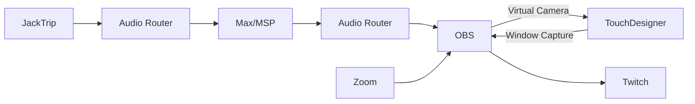
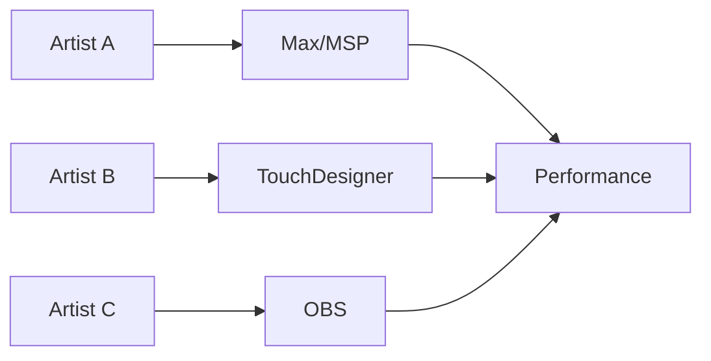
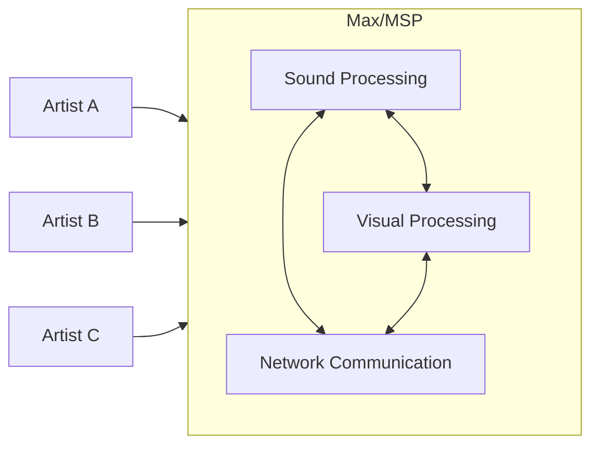
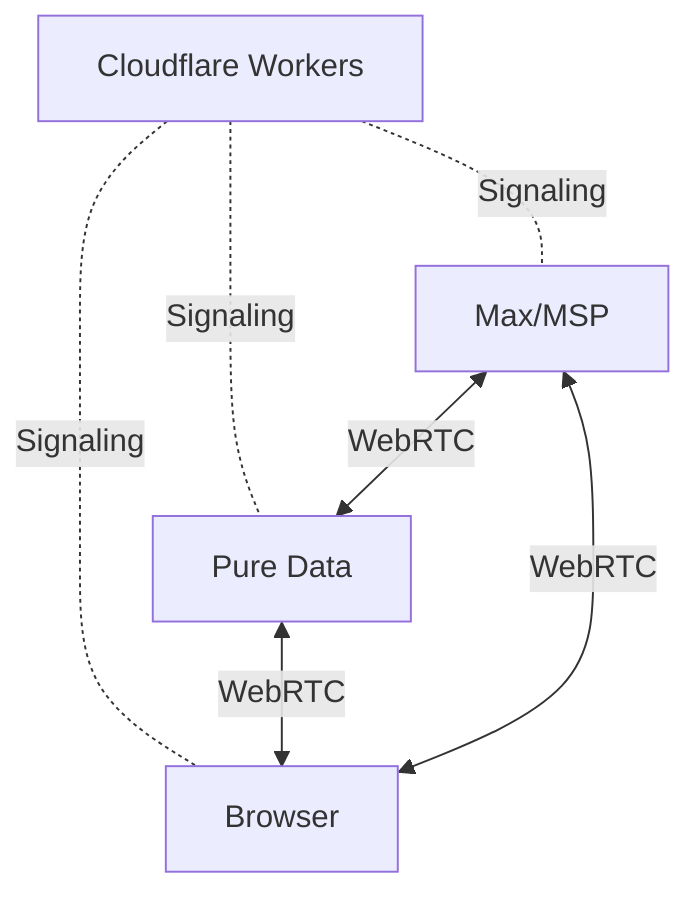

# Towards an Integrated Environment for Telematic Music {font-size="80px"}

Charles K. Neimog

NowNet Arts Conference Forum 2026

## Fragmentation of the Technical Environment {font-size="50px"}

- Multiple software environments.
- Complex audio and video routing.
- Fragmentation of technical knowledge.

## Fragmentation of Artistic Practice

- Technical specialization can become a division of artistic labor.
- Clear boundaries emerge around who controls what.
- This can limit interventions in each other’s work.

## A Shared Technical Environment

## A Shared Technical Environment

- Shared technical knowledge.
- Integration of audiovisual processes.
- Greater permeability between individual contributions.
- Better conditions for collective experimentation.

## Towards a More Organic Environment

In pursuing this idea, I have been exploring whether it is possible to create a more organic technical environment that allows this collective practice to emerge.

## p2p — Recent Experiments

- Recent experiments with p2p using libdatachannel.
- Signaling infrastructure implemented with Cloudflare Workers.
- Audio, video, and messages can circulate within a more unified environment.
- The goal is not only efficiency, but a more shared artistic space.

## Beyond Technical Integration

- Technology as a shared artistic material.
- A more collective relation to the digital environment.
- New possibilities for intervention across artistic roles.
- Search for a more collective creative process in the Telematic.

## Thanks

* https://github.com/charlesneimog/p2p

